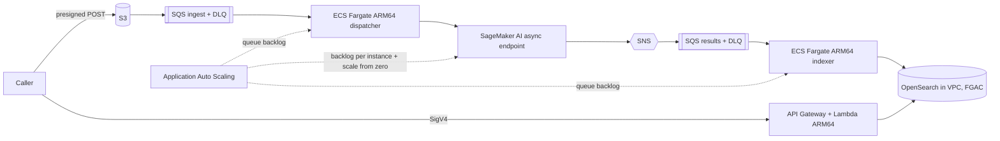

# Elastic Image Analysis Platform

> **Prototype - not for production use.** This is an educational reference implementation for demonstration and
> learning. You are responsible for how you deploy and use it and for the consequences; work with your own
> security and legal teams before any use beyond a disposable sandbox account, following the
> [AWS Shared Responsibility Model](https://aws.amazon.com/compliance/shared-responsibility-model/).
> See the [production hardening checklist](docs/handover.md#production-hardening-checklist).

[中文说明](README.zh-CN.md)

A cloud-native reference for an image analysis platform that replaces a fixed-capacity inference cluster with
elastic, queue-driven capacity: images go to S3 through presigned uploads, ARM64 container workers on ECS Fargate
validate and dispatch them, a SageMaker AI asynchronous endpoint runs the model and scales (down to zero), and
results become searchable in an OpenSearch domain inside a VPC. It ships the load-test and evaluation method to
compare fixed and elastic capacity (relative measures only), complete failure handling (retries, DLQs, idempotent
writes, bad files that never block the queue), and a local mode that runs the whole flow without AWS.

## Architecture



Six CDK stacks: network, storage/queues, inference, search (with the API), compute, observability. Details, trust
boundaries, the async-vs-real-time and CPU-vs-GPU discussion and the fact check: [docs/architecture.md](docs/architecture.md).
How differences to existing samples were established: [docs/prior-art.md](docs/prior-art.md).

## Prerequisites and billing dimensions

- Disposable non-production AWS account, CDK-bootstrapped Region, credentials in the environment.
- Python 3.12+, uv, Node.js, AWS CLI v2, git. No Docker (images are built in CodeBuild).
- Account prerequisites checked (never changed) by `make preflight`: endpoint quota for the instance type, a free
  VPC, service-linked roles, the API Gateway CloudWatch Logs role.
- Billing dimensions (no figures in this repository): endpoint instance time, OpenSearch instance time and storage,
  Fargate vCPU/memory time, interface VPC endpoint hours, requests to API Gateway/Lambda/SQS/SNS/DynamoDB/S3/KMS,
  CloudWatch logs/metrics/alarms, CodeBuild minutes, ECR storage. See each service's official billing page and
  consider an AWS Budgets alert. Details: [docs/deployment-guide.md](docs/deployment-guide.md#billing-dimensions).

## Deployment

```bash
make init                                  # uv sync; copy config/*.example.json -> config/*.json (local, git-ignored)
# edit config/sandbox.json if needed (region, AZs, sizes)
CONFIRM=<LAST_4_DIGITS_OF_ACCOUNT> make deploy   # preflight -> network/storage -> CodeBuild (image + model) -> other stacks
```

Profiles and parameters: [docs/deployment-guide.md](docs/deployment-guide.md). Handover profile:
[docs/handover.md](docs/handover.md).

## Usage and verification

```bash
make verify            # cloud end-to-end: deny paths, D1 basic flow, D3 failures, D4 search
make loadtest          # D2: minimal burst, scaling timeline in out/loadtest-*/timeline.svg
scripts/demo.sh cloud  # both of the above
```

Fixed vs elastic (D5): [docs/evaluation-method.md](docs/evaluation-method.md). Demo script with 10- and 30-minute
versions: [docs/demo-script.md](docs/demo-script.md). Recorded runs: [VERIFICATION.md](VERIFICATION.md),
[DEPLOYMENT-LOG.md](DEPLOYMENT-LOG.md).

## Troubleshooting

| Symptom | Check |
|---|---|
| preflight FAIL on quota/VPC | pick another Region/instance type in the profile; the scripts never request increases |
| images stay `INVOKED` for long | the endpoint may be starting from zero: dashboard "Endpoint backlog and instances", alarm `<PREFIX>-has-backlog-without-capacity` |
| `REJECTED` with a reason | expected for bad files; reasons are listed in `src/imaging/validation.py` |
| ingest DLQ alarm | failed jobs after all attempts or poison messages: docs/handover.md "Operating notes" |
| API answers `degraded: true` | DynamoDB or OpenSearch unavailable; metric `ApiSearchDegraded` / `ApiDependencyErrors` |
| ECS tasks fail to start | CodeBuild image tag missing: re-run `scripts/build.sh`; check `/proto-imaging/codebuild` logs |

## Security and limitations

Controls and their implementation: [SECURITY.md](SECURITY.md). Least privilege, cdk-nag acknowledgements and known
risks: [SECURITY-NOTES.md](SECURITY-NOTES.md). Threats: [THREAT_MODEL.md](THREAT_MODEL.md) (DRAFT). Limitations:
one Region and account, IAM callers only, no multi-tenancy, example model on synthetic images (accuracy is not the
subject), open questions in [OPEN-QUESTIONS.md](OPEN-QUESTIONS.md).

## Clean-up

```bash
CONFIRM_DESTROY=proto-imaging CONFIRM_DATA=yes make destroy   # cdk destroy + service log groups + bootstrap assets of this project
make verify-cleanup                                             # non-zero exit if anything is left
```

Not removed automatically: KMS keys (scheduled deletion, 7-day window), retained data stores of the handover
profile, the CDK bootstrap stack and shared provider assets, bootstrap objects of commits whose asset manifests are
not available. See [docs/cleanup.md](docs/cleanup.md) - do not assume a finished command means everything is gone.

## Repository layout

```
infra/imaging_infra/    CDK stacks, config validation, cdk-nag acknowledgements, trust conditions
src/imaging/            pipeline logic (validation, jobs, dispatcher/indexer, adapters, local mode, simulation, reports)
src/api/                API Lambda handler
src/search_bootstrap/   OpenSearch index + FGAC roles custom resource
model/code/             SageMaker AI inference handler
docker/worker/          worker Dockerfile (built in CodeBuild)
buildspec/              CodeBuild build specification
scripts/                preflight, build, deploy, e2e, load test, simulation, destroy, residual check, demo
config/                 profile templates (*.example.json)
tests/                  unit, integration (local mode), CDK assertion, script and hygiene tests
sample-data/            how to generate the synthetic images
docs/                   architecture, prior art, deployment, demo, evaluation method, handover, clean-up, standards review
```

## Local testing

```bash
make lint test         # ruff, unit/integration/CDK tests (no AWS)
make demo-offline      # D1-D5 in local mode + simulation
make synth             # both profile templates with cdk-nag
make scan              # gitleaks full history + canary
```

## Contributing

See [CONTRIBUTING](CONTRIBUTING.md) for more information.

## Security

See [SECURITY.md](SECURITY.md) for how to report a security issue.

## License

This library is licensed under the MIT-0 License. See the [LICENSE](LICENSE) file.
