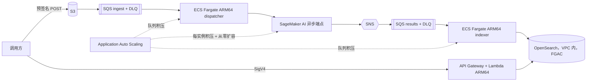

# 弹性影像分析平台（Elastic Image Analysis Platform）

> **Prototype，不用于生产。** 本项目仅用于演示和学习。部署、使用及其后果由使用方负责；在可丢弃的沙箱账号之外使用前，
> 请与自己的安全和法务团队评估，遵循 [AWS 责任共担模型](https://aws.amazon.com/compliance/shared-responsibility-model/)。
> 上生产前的加固清单见 [docs/handover.md](docs/handover.md#production-hardening-checklist)。

[English](README.md)

把固定容量的推理集群换成按队列弹性伸缩的云原生影像分析参考实现：影像经预签名上传进入 S3，ECS Fargate 上的 ARM64
容器负责校验与分发，SageMaker AI 异步推理端点承载模型并按积压伸缩（可缩到零），结果写入 VPC 内的 OpenSearch 域供检索。
仓库同时提供「固定容量 vs 弹性容量」的压测与评估方法（只给相对关系）、完整的失败处理（重试、死信队列、幂等写入、坏文件不阻塞队列），
以及不依赖 AWS 即可跑通全流程的本地模拟模式。

## 架构

六个 CDK 栈：network、storage（存储/队列）、inference（推理）、search（检索，含 API）、compute（计算）、observability（观测）。
组件、信任边界、异步与实时推理取舍、CPU 与 GPU 推理、事实核对见 [docs/architecture.md](docs/architecture.md)；
与已有资产的差异见 [docs/prior-art.md](docs/prior-art.md)。

## 前置条件与计费维度

- 可丢弃的非生产 AWS 账号，目标区域已完成 CDK bootstrap，凭证在环境变量中。
- Python 3.12+、uv、Node.js、AWS CLI v2、git。不需要 Docker（镜像在 CodeBuild 中构建）。
- `make preflight` 只读检查（从不修改）：实例类型的端点配额、可用的 VPC 配额、服务关联角色、API Gateway 的 CloudWatch Logs 角色。
- 计费维度（仓库内不写任何数字）：端点实例时长、OpenSearch 实例时长与存储、Fargate vCPU/内存时长、接口型 VPC 端点时长、
  API Gateway/Lambda/SQS/SNS/DynamoDB/S3/KMS 请求、CloudWatch 日志/指标/告警、CodeBuild 构建分钟、ECR 存储。
  以各服务官方计费页面为准，建议为账号配置 AWS Budgets 告警。详见 [docs/deployment-guide.md](docs/deployment-guide.md#billing-dimensions)。

## 部署

部署命令只在英文 README 的「Deployment」一节维护：`make init` 后执行 `CONFIRM=<账号末四位> make deploy`
（preflight → network/storage → CodeBuild 构建镜像与模型 → 其余栈）。参数说明见 [docs/deployment-guide.md](docs/deployment-guide.md)，
交接配置见 [docs/handover.md](docs/handover.md)。

## 使用与验证

- `make verify`：云上端到端（拒绝路径、D1 基本链路、D3 失败处理、D4 检索）。
- `make loadtest`：D2 最小突发压测，扩缩容时间线输出到 `out/loadtest-*/timeline.svg`。
- 固定容量对照（D5）：[docs/evaluation-method.md](docs/evaluation-method.md)。演示脚本（10 分钟 / 30 分钟版）：
  [docs/demo-script.md](docs/demo-script.md)。实际运行记录：[VERIFICATION.md](VERIFICATION.md)、[DEPLOYMENT-LOG.md](DEPLOYMENT-LOG.md)。

## 故障排查

| 现象 | 检查 |
|---|---|
| preflight 配额/VPC 失败 | 在配置里换区域或实例类型；脚本不会申请提升配额 |
| 影像长时间停在 `INVOKED` | 端点可能正从零启动：看仪表盘「Endpoint backlog and instances」和告警 `<PREFIX>-has-backlog-without-capacity` |
| `REJECTED` 带原因码 | 坏文件的预期结果，原因码见 `src/imaging/validation.py` |
| ingest DLQ 告警 | 重试用尽的任务或毒消息，处理方式见 docs/handover.md「Operating notes」 |
| API 返回 `degraded: true` | DynamoDB 或 OpenSearch 不可用；指标 `ApiSearchDegraded` / `ApiDependencyErrors` |
| ECS 任务起不来 | 镜像标签不存在：重跑 `scripts/build.sh`，查看 `/proto-imaging/codebuild` 日志 |

## 安全与局限

控制项与实现位置：[SECURITY.md](SECURITY.md)；最小权限、cdk-nag 抑制理由、已知风险：[SECURITY-NOTES.md](SECURITY-NOTES.md)；
威胁模型：[THREAT_MODEL.md](THREAT_MODEL.md)（DRAFT）。局限：单区域单账号、仅 IAM 调用方、不做多租户、示例模型跑合成影像（不讨论准确率）；
待确认问题见 [OPEN-QUESTIONS.md](OPEN-QUESTIONS.md)。

## 清理

`make destroy`（两次确认；`cdk destroy` + 服务自建日志组 + 本项目的 bootstrap 资产）之后执行 `make verify-cleanup`，有残留时非零退出。
不会被自动删除：KMS 密钥（计划删除，7 天窗口）、handover 配置保留的数据存储、CDK bootstrap 栈及共享 provider 资产、
无法按哈希识别的旧提交资产。详见 [docs/cleanup.md](docs/cleanup.md)——命令跑完不等于删干净，以残留核对结论为准。

## 目录结构

见英文 README「Repository layout」。

## 本地测试

`make lint test`（不需要 AWS）、`make demo-offline`（本地模式 D1–D5 + 仿真）、`make synth`（两套配置 + cdk-nag）、`make scan`（gitleaks 全历史 + canary）。

## 参与贡献

见 [CONTRIBUTING](CONTRIBUTING.md)。

## 安全问题上报

见 [SECURITY.md](SECURITY.md)。

## 许可证

本项目以 MIT-0 许可证发布，见 [LICENSE](LICENSE)。
