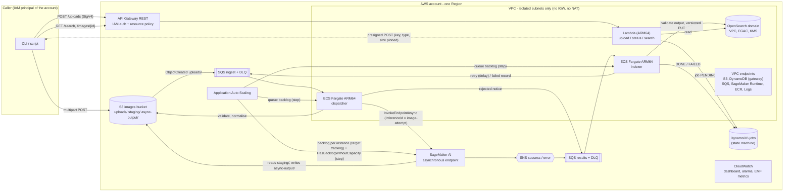

# Architecture

Applies to tag `v0.1.0`. The mermaid diagram below is the source of truth for the topology; the CDK code in
`infra/imaging_infra/` implements it.

## Components and data flow

Stacks (`proto-imaging-*`): `network` (VPC, endpoints, security groups), `storage` (KMS keys, buckets, queues,
topics, job table, ECR repository, CodeBuild project), `inference` (model, endpoint configuration, endpoint,
scaling), `search` (domain, bootstrap custom resource, API and its Lambda), `compute` (cluster, two
services, scaling), `observability` (dashboard, alarms, alarm topic).

## Trust boundaries

1. **Caller -> API**: SigV4 (IAM) only; the resource policy allows principals of this account
   (`aws:PrincipalAccount`), and in the handover profile also requires the execute-api VPC endpoint
   (`aws:SourceVpce`, PRIVATE endpoint type). Body and parameters are validated twice (API Gateway model /
   validator, then the handler with fixed patterns).
2. **Caller -> S3**: only through the presigned POST: key, Content-Type and a content-length range are part
   of the signed policy, so S3 refuses any other key, type or size (checked in the cloud run).
3. **Uploaded bytes -> worker**: untrusted. The dispatcher reads with a byte cap, checks magic bytes against
   the declared type, opens with Pillow under a pixel limit, verifies, and re-encodes to a fresh JPEG. The model
   container receives only that re-encoded image, from the `staging/` prefix.
4. **Model output -> index**: untrusted. The indexer reads at most 64 KiB, rejects NaN/Infinity, wrong types,
   out-of-range classes and scores, extra items; nothing else is copied. Validation failures log a field path
   and keyword only.
5. **Workers / API -> OpenSearch**: FGAC with an IAM master role used only by the bootstrap; the indexer role is
   mapped to a write-only role on one index, the API role to a read-only role on that index.

## Inference: asynchronous vs real-time (FR-3)

| | Asynchronous endpoint (chosen) | Real-time endpoint (alternative) |
|---|---|---|
| Fits | batch arrivals, large payloads, bursty load that may queue | interactive calls needing a synchronous answer |
| Queue | built-in internal queue; requests wait when capacity is busy or zero | caller must retry/queue itself |
| Scale to zero | supported for asynchronous endpoints (MinCapacity 0); requests that arrive at zero are queued | not with a plain variant; see the docs for inference components |
| Results | written to S3, SNS success/error notifications | in the HTTP response |
| What changes here | nothing (default) | the dispatcher would call `InvokeEndpoint` and write results directly; queue-driven worker scaling still applies |

Use real-time when a person waits for the answer and the model fits the synchronous limits; use asynchronous
for everything that can wait, especially when idle periods are long.

## Two-layer scaling (FR-5)

| Layer | Scalable target | Policy | Parameters (profile) |
|---|---|---|---|
| Dispatcher tasks | `ecs:service:DesiredCount` | step scaling on ingest queue *visible + in flight* (1-minute maximum): `>= steps[i].lower` adds `steps[i].change`; `== 0` for 2 minutes removes one | `workers.dispatcher.*` |
| Indexer tasks | same | same on the results queue | `workers.indexer.*` |
| Endpoint instances | `sagemaker:variant:DesiredInstanceCount` | target tracking on `ApproximateBacklogSizePerInstance` + step `+1` when `HasBacklogWithoutCapacity >= 1` for 2 of 2 minutes | `inference.*` |

Why visible + in flight: a queue with only in-flight messages still has work being processed; scaling in on
"visible = 0" alone would stop tasks mid-batch. Why the extra step policy: with zero instances the endpoint only
starts again once the backlog exceeds the target value; the documented `HasBacklogWithoutCapacity` policy
starts one instance for any queued request.

Cold start contributors (what the load test records separately): ECS task start (image pull through the ECR
endpoints, container start); endpoint instance provisioning, prebuilt image pull and model load; alarm
evaluation periods and cooldowns in both layers. The load test reports time to first endpoint instance and the
scaling activity timestamps so each contributor is visible; it does not claim any value for them.

## CPU (Graviton) inference vs GPU

The sandbox profile runs the endpoint on a Graviton CPU instance type with the prebuilt arm64 PyTorch inference
image. Reasons: the example model is small (ResNet-18); GPU endpoint quotas in shared sandbox accounts are small
and contested (the account's Service Quotas showed non-zero but limited GPU endpoint quotas and larger Graviton
quotas, read-only, 2026-10-21); the point of the prototype is the scaling behaviour, which is the same on CPU.
GPU instances are not Graviton - a justified exception to the Graviton-first rule, available by setting
`inference.architecture = "x86"`, `accelerator = "gpu"` and a GPU instance type in the profile (the arm64 image is
CPU-only, so the configuration refuses arm64 + gpu).

When CPU inference is workable is a measurement, not an assumption. Run the load test with the target model and
the expected load shape and read: `items_per_endpoint_instance_minute`, the endpoint's `TimeInBacklog`, the
instance `CPUUtilization`, and the end-to-end percentiles against the business requirement. CPU tends to be the
candidate when the model is small, inputs are normalised to a fixed size, and the workload tolerates queueing
(asynchronous); GPU when per-item compute dominates and the latency requirement cannot be met by adding CPU
instances. Neither statement substitutes for the measurement (see `docs/evaluation-method.md`).

## Failure handling (FR-6)

| Failure | Handling | Where |
|---|---|---|
| Malformed message, foreign key, S3 test event | acknowledged and counted; never retried | `messages.py`, `pipeline.py` |
| Bad file (corrupt, wrong type, bomb, dimensions, too large, empty) | job `REJECTED` with a reason code, rejected document indexed, message deleted: the queue keeps flowing | `validation.py`, `Dispatcher._reject` |
| Transient dependency error (throttling, search unavailable) | exception -> message stays, visibility set to exponential backoff by receive count; DLQ after `max_receive_count` | `runner.py`, queue redrive policy |
| Inference failure or timeout (error notification) | indexer schedules attempt n+1 on the ingest queue with exponential delay up to `max_inference_attempts`; then `FAILED`, failed document, record in the ingest DLQ | `Indexer._notification` |
| Invalid model output | `FAILED` with `invalid_model_output`; raw output never stored or logged | `model_output.py` |
| Duplicate S3 event / SQS redelivery / SNS replay | conditional job transitions (status + attempt + lease); deterministic InferenceId; document ID = image ID with external versioning (same version = no write) | `jobs.py`, `OpenSearchIndex.put` |
| Worker crash between claim and invoke | `DISPATCHING` lease expires after the visibility timeout; the redelivered message re-claims | `jobs.py` |
| API dependency failure | 200 with `degraded: true` and a metric, never a 5xx | `src/api/handler.py` |

## OpenSearch Service domain vs OpenSearch Serverless

Chosen: an OpenSearch Service domain in the VPC with fine-grained access control. OpenSearch Serverless was
evaluated (see DECISIONS.md): it would remove node sizing, but authorisation uses data access policies instead
of FGAC roles (the requirement names FGAC), VPC access needs a separate Serverless VPC endpoint, and the
idempotent write path relies on external versioning, which was verified for the domain API and not for
Serverless. For a longer-lived deployment with unpredictable query load, Serverless is worth re-evaluating.

## Limits and known gaps

- One Region, one AWS account, no multi-tenancy, no end-user identity (IAM callers only).
- A job whose notification is lost (the endpoint's `NotificationFailures` metric) stays `INVOKED`; a sweeper that
  re-checks old `INVOKED` jobs against `async-output/` is in the hardening checklist.
- The local mode reproduces the semantics, not the timing, of the services; the simulation reproduces the shape
  of the scaling policies, not their real delays.
- Scale-in of the endpoint is governed by target-tracking alarms and cooldowns; observe it in the timeline rather
  than expecting it immediately after the load ends.

## Region differences

Default deployment Region is taken from the profile. Check before deploying elsewhere (`make preflight` checks the
first four):

- SageMaker AI endpoint instance types per Region: Service Quotas lists "<TYPE> for endpoint usage" per Region;
  the asynchronous inference troubleshooting page points to the per-Region instance list.
- OpenSearch instance types per engine version: `aws opensearch list-instance-type-details`.
- Prebuilt arm64 PyTorch inference images: the SDK image table lists registries per Region.
- Fargate ARM64: not supported in the `use1-az3` zone of us-east-1.
- During the sandbox run, us-east-1 had no VPC quota left (other projects); the run used us-west-2. See DEPLOYMENT-LOG.md.

## Fact check

Checked 2026-10-21 against official pages (or official APIs where noted).

| # | Statement | Source |
|---|---|---|
| 1 | Asynchronous endpoints can scale to zero (MinCapacity 0); requests received at zero instances are queued | https://docs.aws.amazon.com/sagemaker/latest/dg/async-inference-autoscale.html |
| 2 | Recommended scaling metric is `ApproximateBacklogSizePerInstance` with target tracking | same page |
| 3 | Without the extra policy, an endpoint at zero scales out only once the backlog exceeds the target; `HasBacklogWithoutCapacity` step policy (2/2 one-minute datapoints >= 1) scales out from zero | same page; https://docs.aws.amazon.com/sagemaker/latest/dg/async-inference-troubleshooting.html |
| 4 | Asynchronous endpoint metrics: ApproximateBacklogSize(PerInstance), ApproximateAgeOfOldestRequest, HasBacklogWithoutCapacity, TimeInBacklog, InvocationFailures, NotificationFailures, ...; platform log group `/aws/sagemaker/Endpoints/<NAME>` | https://docs.aws.amazon.com/sagemaker/latest/dg/async-inference-monitor.html |
| 5 | SNS success/error notifications with `inferenceId`, `invocationStatus`, `responseParameters.outputLocation` | https://docs.aws.amazon.com/sagemaker/latest/dg/async-inference-check-predictions.html , https://docs.aws.amazon.com/sagemaker/latest/APIReference/API_AsyncInferenceNotificationConfig.html |
| 6 | InvokeEndpointAsync: `InferenceId` up to 64 characters; `InvocationTimeoutSeconds` 1-3600 (default 900); `RequestTTLSeconds` 60-21600 (default 21600) | https://docs.aws.amazon.com/sagemaker/latest/APIReference/API_runtime_InvokeEndpointAsync.html |
| 7 | `MaxConcurrentInvocationsPerInstance` 1-1000 | https://docs.aws.amazon.com/sagemaker/latest/APIReference/API_AsyncInferenceClientConfig.html |
| 8 | SageMaker AI does not retry a container error; asynchronous limits on payload size, processing time and queue TTL are listed on the troubleshooting page | https://docs.aws.amazon.com/sagemaker/latest/dg/async-inference-troubleshooting.html |
| 9 | Confused-deputy guidance for inference roles: `aws:SourceArn` = `arn:aws:sagemaker:<REGION>:<ACCOUNT>:*` | https://docs.aws.amazon.com/sagemaker/latest/dg/security-confused-deputy-prevention.html |
| 10 | Graviton instances are available for SageMaker inference with prebuilt Graviton PyTorch containers | https://aws.amazon.com/blogs/machine-learning/run-machine-learning-inference-workloads-on-aws-graviton-based-instances-with-amazon-sagemaker/ ; tag `2.6.0-cpu-py312-ubuntu22.04-sagemaker` of `pytorch-inference-arm64` confirmed with `ecr:DescribeImages` (test-time check) |
| 11 | FGAC recommended configuration: IAM master user, access policy allowing the account's principals, optional Deny on `_dashboards*`; IAM roles mapped as backend roles | https://docs.aws.amazon.com/opensearch-service/latest/developerguide/fgac.html |
| 12 | VPC domains: access controlled by security groups and the access policy; IP-based policies do not apply | https://docs.aws.amazon.com/opensearch-service/latest/developerguide/vpc.html |
| 13 | OpenSearch Serverless measures capacity in OCUs; time-series collections cannot index by custom document ID | https://docs.aws.amazon.com/opensearch-service/latest/developerguide/serverless-overview.html |
| 14 | S3 event notifications to a queue encrypted with a customer managed key need `kms:GenerateDataKey`/`kms:Decrypt` for `s3.amazonaws.com` in the key policy | https://docs.aws.amazon.com/AmazonS3/latest/userguide/grant-destinations-permissions-to-s3.html |
| 15 | ECS on Fargate supports Linux/ARM64 (platform 1.4.0+), except zone `use1-az3` | https://docs.aws.amazon.com/AmazonECS/latest/developerguide/ecs-arm64.html |
| 16 | Model weights `timm/resnet18.a1_in1k` are published under Apache-2.0; parameter names load strictly into torchvision ResNet-18 | https://huggingface.co/timm/resnet18.a1_in1k (license metadata via the Hub API); strict `load_state_dict` verified locally (test-time check) |
| 17 | torchvision notes that pre-trained weights may carry terms derived from their training data | https://docs.pytorch.org/vision/stable/models.html |
| 18 | Presigned POST conditions (`Content-Type`, `content-length-range`) via boto3 | https://boto3.amazonaws.com/v1/documentation/api/latest/reference/services/s3/client/generate_presigned_post.html ; enforcement verified in the cloud run (oversize, changed key, changed type refused) |
| 19 | CDK `QueueProcessingFargateService` scales on `ApproximateNumberOfMessagesVisible` (prior art) | https://docs.aws.amazon.com/cdk/api/v2/python/aws_cdk.aws_ecs_patterns/QueueProcessingFargateService.html |
| 20 | Backlog per instance as an SQS scaling metric (prior art, EC2 Auto Scaling) | https://docs.aws.amazon.com/autoscaling/ec2/userguide/as-using-sqs-queue.html |
| 21 | Distributed Load Testing on AWS targets HTTP endpoints (prior art) | https://aws.amazon.com/solutions/implementations/distributed-load-testing-on-aws/ |

Statements that could not be confirmed on an official page were removed (for example, figures for cold-start
duration; the project measures them instead).
